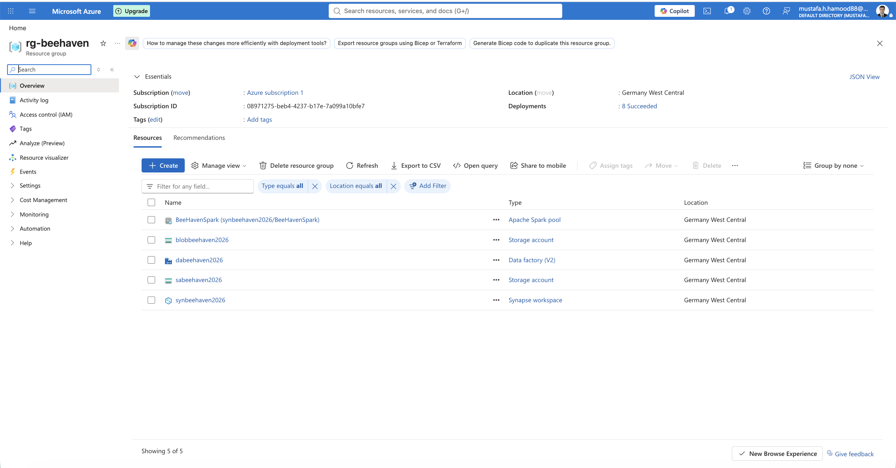
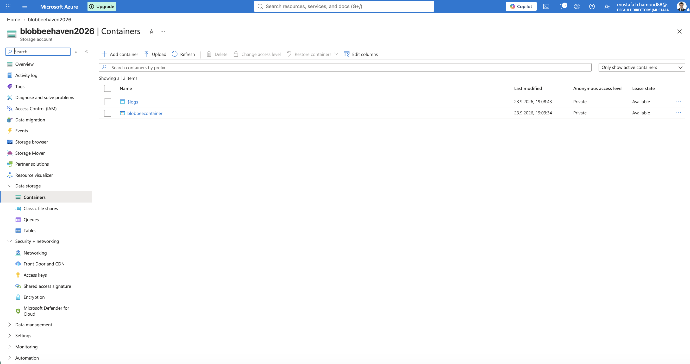
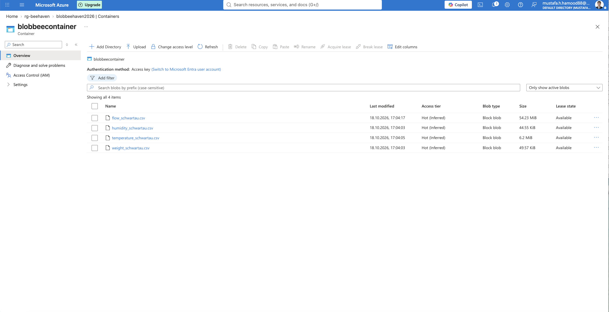
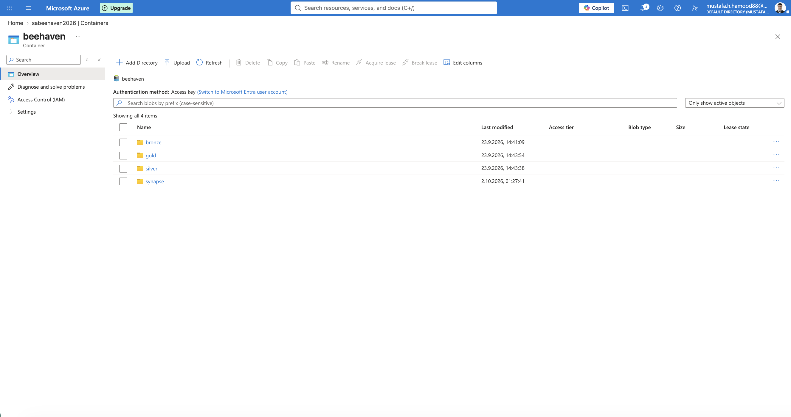
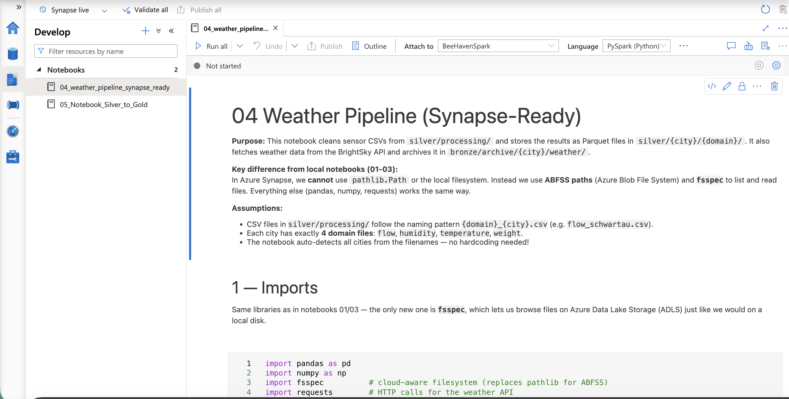
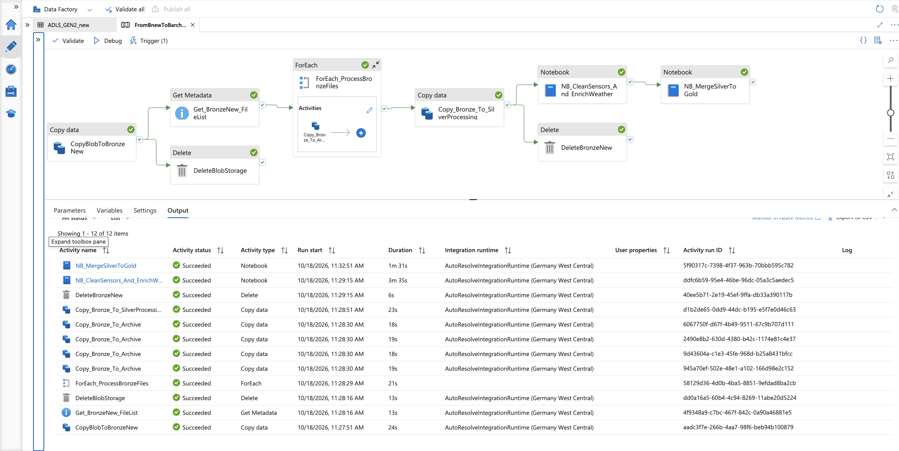
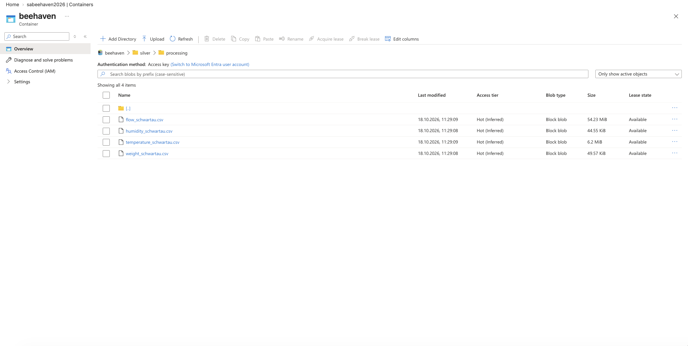
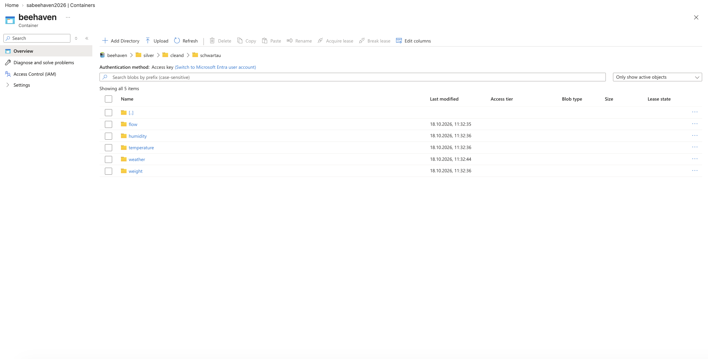
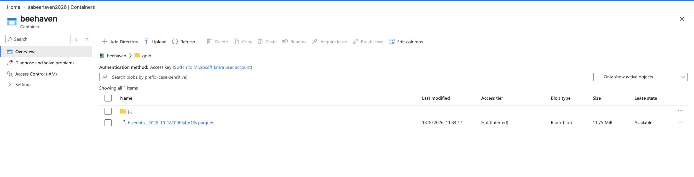

# Bee Haven – Azure Data Engineering Pipeline

## Project Notebooks

<p align="center">
  
  
  
  
  
  
  
  
  
  
</p>

<p align="center">
  <a href="notebooks/04_weather_pipeline_synapse_ready.ipynb">
    
  </a>
  &nbsp;
  <a href="notebooks/05_Notebook_Silver_to_Gold.ipynb">
    
  </a>
</p>

---
## Table of Contents

1. [Introduction](#1-introduction)
2. [Features](#2-features)
3. [Getting Started](#3-getting-started)
   - [Prerequisites](#prerequisites)
   - [Project Structure](#project-structure)
4. [Project Workflow](#4-project-workflow)
   - [Azure Infrastructure Setup](#azure-infrastructure-setup)
   - [Data Ingestion and Archiving](#data-ingestion-and-archiving)
   - [Data Transformation with Azure Synapse Analytics](#data-transformation-with-azure-synapse-analytics)
   - [Gold Layer Generation](#gold-layer-generation)
5. [Project Components](#5-project-components)
6. [Step-by-Step Visual Guide](#6-step-by-step-visual-guide)
7. [Technologies Used](#7-technologies-used)
8. [Skills Demonstrated](#8-skills-demonstrated)

---

## 1. Introduction

**Bee Haven** is a cloud-based data engineering project built with Microsoft Azure. It demonstrates an end-to-end data pipeline for processing beehive sensor data and enriching it with external weather information.

The project uses Azure Blob Storage for raw data ingestion, Azure Data Lake Storage Gen2 for organizing data into processing layers, Azure Data Factory for pipeline orchestration, and Azure Synapse Analytics for data transformation and integration.

The pipeline processes flow, humidity, temperature, and weight measurements, enriches the dataset with weather information, and produces a consolidated Parquet dataset in the Gold layer.

The project follows a layered data architecture inspired by the **Bronze, Silver, and Gold** approach.

## 2. Features

- **Cloud-based data ingestion:** Transfers raw CSV files from Azure Blob Storage into Azure Data Lake Storage Gen2.
- **Bronze layer and archiving:** Organizes incoming data and preserves archived source files.
- **Automated pipeline orchestration:** Coordinates ingestion, file management, notebook execution, and data processing through Azure Data Factory.
- **Sensor data cleaning:** Processes flow, humidity, temperature, and weight measurements using Azure Synapse Analytics notebooks.
- **Weather data enrichment:** Integrates external weather information using the Bright Sky weather API.
- **Silver layer processing:** Stores cleaned and transformed datasets in Parquet format.
- **Gold layer integration:** Combines sensor and weather data into a consolidated dataset.
- **Pipeline monitoring:** Uses Azure Data Factory execution results to verify successful completion of the pipeline activities.

## 3. Getting Started

### Prerequisites

To explore or reproduce this project, the following are required:

- An Azure subscription.
- An Azure Storage account with Blob Storage capabilities.
- Azure Data Lake Storage Gen2 with hierarchical namespace enabled.
- Azure Data Factory.
- Azure Synapse Analytics and a configured Apache Spark pool.
- Access to the Bright Sky weather API.
- Python and Apache Spark familiarity for understanding the transformation notebooks.
- Git and GitHub for version control.

**Note:** The project uses Azure resources and configurations. Running the notebooks may require updating storage paths, permissions, linked services, and other environment-specific settings.

### Project Structure

```text
Bee-haven/
├── data/
│   └── schwartau.zip
├── images/
│   ├── 01_resource_group.png
│   ├── 02_storage_account.png
│   ├── 03_blob_raw_data.png
│   ├── 04_adls_gen2_hierarchical_namespace.png
│   ├── 05_azure_synapse_notebooks.png
│   ├── 06_adf_complete_pipeline_success.png
│   ├── 07_bronze_archive_raw_data.png
│   ├── 08_silver_processing_raw_csvs.png
│   ├── 09_silver_cleaned_processed_data.png
│   └── 10_gold_final_hivedata.png
├── notebooks/
│   ├── 04_weather_pipeline_synapse_ready.ipynb
│   └── 05_Notebook_Silver_to_Gold.ipynb
├── .gitignore
└── README.md
```

The `data/schwartau.zip` archive contains the raw dataset included with the project. The `images/` directory documents the Azure infrastructure, pipeline execution, and resulting data layers. The notebooks contain the data transformation logic.

The generated Gold Parquet output is stored in Azure Data Lake Storage rather than committed to this repository.

## 4. Project Workflow

The pipeline coordinates the movement of data from the source Blob Storage container through the Bronze and Silver layers and finally into the Gold layer.

### Azure Infrastructure Setup

The Azure environment consists of the following main components:

- **Azure Resource Group:** Organizes the project's Azure resources.
- **Azure Blob Storage:** Holds the original sensor CSV files.
- **Azure Data Lake Storage Gen2:** Provides hierarchical storage for the Bronze, Silver, and Gold layers.
- **Azure Data Factory:** Orchestrates data movement, file management, and notebook execution.
- **Azure Synapse Analytics:** Executes Spark-based data cleaning, enrichment, and integration.

The Data Lake uses a hierarchical namespace to organize files and directories into a structured data architecture.

### Data Ingestion and Archiving

The ingestion stage transfers raw sensor CSV files from Blob Storage into the `bronze/new` directory in Data Lake Storage Gen2.

Azure Data Factory then coordinates the following operations:

1. Copy raw files from Blob Storage into the Bronze layer.
2. Retrieve file metadata to support downstream processing.
3. Copy source files into the Bronze archive.
4. Transfer the files required for processing into `silver/processing`.
5. Remove temporary files from the ingestion directory after the corresponding copy operations complete.

This approach separates the incoming data from archived source data and files awaiting transformation.

### Data Transformation with Azure Synapse Analytics

The first Synapse notebook, `04_weather_pipeline_synapse_ready.ipynb`, processes the raw sensor data and enriches it with weather information.

The notebook handles the following sensor domains:

- Flow
- Humidity
- Temperature
- Weight

It also retrieves weather information through the Bright Sky API and prepares the resulting datasets for downstream integration.

The cleaned and transformed data is written to the Silver layer in Parquet format. The current Azure implementation uses the directory `silver/cleand/schwartau/` for the processed domain datasets.

The raw weather source data is also preserved in the Bronze archive.

### Gold Layer Generation

The second notebook, `05_Notebook_Silver_to_Gold.ipynb`, combines the processed Silver datasets into a consolidated dataset.

The integration includes the following domains:

- Flow measurements
- Humidity measurements
- Temperature measurements
- Weight measurements
- Weather information

The datasets are integrated by timestamp to create a unified view of the available sensor and weather information.

The final dataset is written in Parquet format to the `gold/` directory. The output filename includes a timestamp to distinguish generated results.

The final Gold dataset represents the output of the end-to-end pipeline and is intended for downstream analytics.

## 5. Project Components

| Component | Responsibility |
|---|---|
| Azure Blob Storage | Stores the original sensor CSV files. |
| Bronze layer | Receives incoming data and preserves archived source files. |
| Silver processing directory | Holds raw files prepared for transformation. |
| Synapse Notebook 04 | Cleans sensor data and enriches it with weather information. |
| Silver layer | Stores transformed sensor and weather datasets in Parquet format. |
| Synapse Notebook 05 | Integrates Silver datasets into a consolidated output. |
| Gold layer | Stores the final integrated Parquet dataset. |
| Azure Data Factory | Orchestrates the end-to-end workflow and monitors activity execution. |

### Azure Data Factory Pipeline

The end-to-end pipeline includes these key activities:

- `CopyBlobToBronzeNew` — copies the source files into the Bronze ingestion directory.
- `DeleteBlobStorage` — performs the configured source-side deletion operation.
- `Get_BronzeNew_FileList` — retrieves metadata for files in the Bronze ingestion directory.
- `ForEach_ProcessBronzeFiles` — coordinates file processing, including copying files to the archive and Silver processing directories.
- `DeleteBronzeNew` — removes temporary files from the Bronze ingestion directory after processing.
- `NB_CleanSensors_And_EnrichWeather` — runs the sensor cleaning and weather enrichment notebook.
- `NB_MergeSilverToGold` — runs the notebook that integrates the Silver datasets and generates the Gold output.

The successful pipeline execution is documented in the visual guide below.

## 6. Step-by-Step Visual Guide

### Step 1: Azure Resource Group

The resource group provides a central place to manage the Azure resources used by the project.



### Step 2: Storage Account

The storage account provides the cloud storage infrastructure used by the pipeline.



### Step 3: Raw Data in Blob Storage

The source container holds the original CSV files containing flow, humidity, temperature, and weight measurements.



### Step 4: Azure Data Lake Storage Gen2

The Data Lake uses hierarchical namespace support to organize files into directories and processing layers.



### Step 5: Azure Synapse Analytics Notebooks

The Synapse workspace contains the notebooks responsible for transforming the sensor data, enriching it with weather information, and producing the final integrated dataset.



### Step 6: Successful End-to-End Pipeline Execution

The Azure Data Factory pipeline coordinates the ingestion, archiving, Silver processing, and Gold generation activities.

The screenshot shows the pipeline activities completing successfully.



### Step 7: Bronze Archive

The Bronze archive preserves source data in a structured directory layout for traceability and potential reprocessing.


### Step 8: Silver Processing Directory

The Silver processing directory contains the raw CSV files transferred from the ingestion stage and prepared for transformation.



### Step 9: Cleaned Silver Data

After processing, the Silver layer contains the transformed datasets organized by domain, including flow, humidity, temperature, weather, and weight.



### Step 10: Final Gold Dataset

The final integration step produces a consolidated Parquet file in the Gold directory of Azure Data Lake Storage Gen2.



## 7. Technologies Used

- **Microsoft Azure**
- **Azure Blob Storage**
- **Azure Data Lake Storage Gen2**
- **Azure Data Factory**
- **Azure Synapse Analytics**
- **Apache Spark**
- **Python**
- **Pandas and PySpark**, where used in the notebooks
- **Parquet**
- **Bright Sky Weather API**
- **Jupyter Notebooks**
- **Git and GitHub**

## 8. Skills Demonstrated

This project demonstrates practical experience with:

- Designing a cloud-based data engineering workflow.
- Organizing data using a Bronze, Silver, and Gold architecture.
- Ingesting and managing files in Azure Storage services.
- Orchestrating multi-step pipelines with Azure Data Factory.
- Processing structured data with Python and Spark notebooks.
- Enriching datasets with external API data.
- Integrating multiple datasets by timestamp.
- Writing analytical data in Parquet format.
- Monitoring pipeline execution and validating generated outputs.
- Documenting cloud architecture and data processing results.

---

**Project:** Bee Haven – Azure Data Engineering Pipeline  
**Repository:** [Bee-haven on GitHub](https://github.com/Mustafa-Al-Hamoud/Bee-haven)

---

## 9. Author

**Mustafa Al Hamoud**

IT Engineer | Data Engineering Enthusiast

GitHub: [Mustafa-Al-Hamoud](https://github.com/Mustafa-Al-Hamoud)

---

## 10. Acknowledgements

This project was developed as a hands-on data engineering project to demonstrate the design and implementation of an end-to-end data pipeline using Microsoft Azure.

It combines beehive sensor data with external weather information using the Bright Sky Weather API.

The project demonstrates practical applications of cloud storage, data orchestration, data transformation, and data integration.

---

⭐ If you found this project interesting, feel free to give it a star on GitHub!

The screenshots included in this repository document the Azure infrastructure, successful pipeline execution, and the resulting Bronze, Silver, and Gold data layers.
